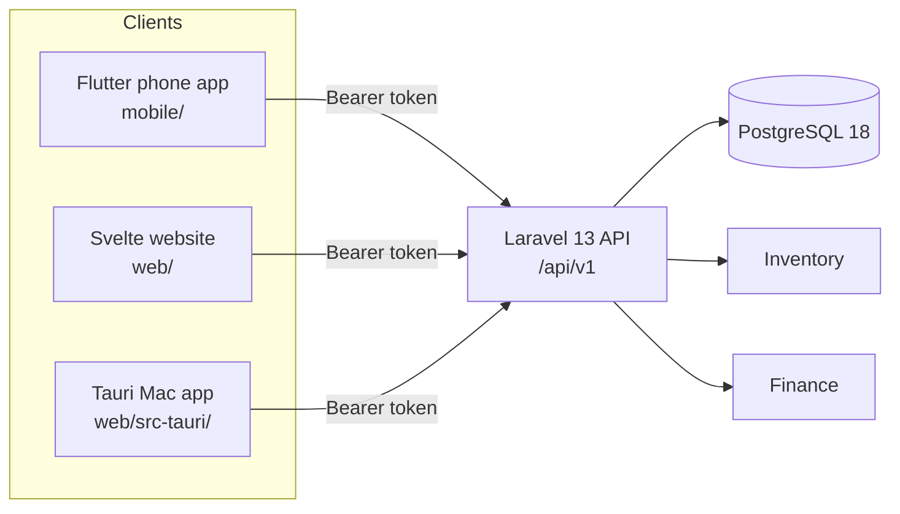
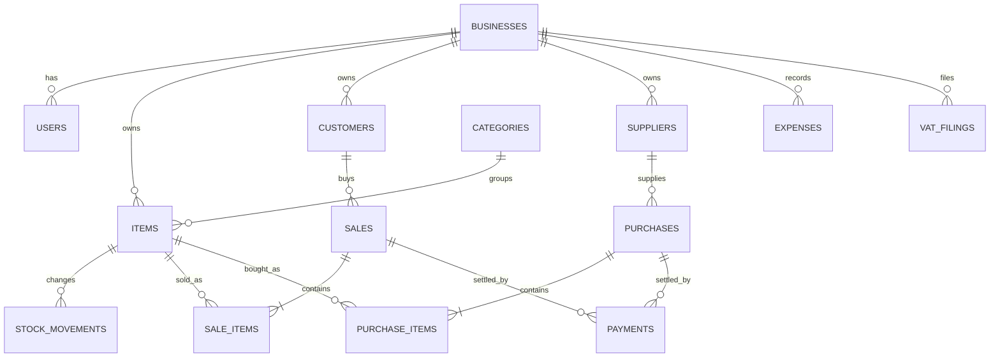
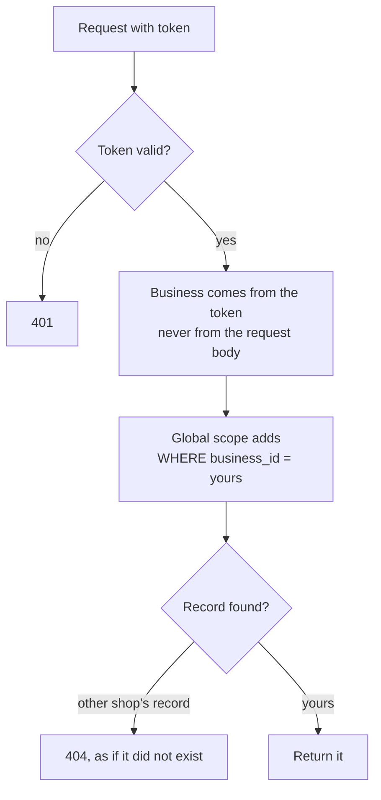

# PASAL

PASAL is a stock and money system for small shops in Nepal. It tracks what is on the shelf, what was sold, who still owes the shop money, and what the VAT return should say at the end of the month.

I built it for our own family business first. Then I made it work for many shops at once, each one fully separate from the others.

**Where it stands today:** the backend API is finished and tested (67 routes, 168 automatic tests). The Svelte website and the Flutter phone app both have every screen from the plan, built against that API. Both run on a local computer only. Nothing here is deployed yet, and I say so on purpose. The [security notes](docs/security.md) list what is still open. The Mac app (Tauri, around the website screens) builds but I have not opened it yet.

## What it does

- **Inventory.** Categories, items, suppliers, stock in and out, manual stock corrections, low-stock alerts.
- **Sales and purchases.** A sale can be paid in full, part paid, or left unpaid. Payments come in later and are matched to the sale.
- **Udhar (customer credit).** The system keeps a running balance per customer and per supplier.
- **Expenses and reports.** A profit summary for any date range.
- **IRD VAT.** A monthly preview with the numbers the return asks for, and saved filings per period.
- **Many shops, one system.** Invite-only. A shop has an `owner` and `staff`. Staff can run the counter but cannot see buying prices.

## How the pieces fit



The API is the only place with business rules. The clients stay thin and only call the endpoints in the [API reference](docs/api-reference.md).

## One sale, start to finish

A sale touches three tables. They are written inside one database transaction, so a sale is either saved completely or not at all.


Stock is never edited by hand. It is the sum of `stock_movements`, with a cached `quantity` on each item that changes in the same transaction.

## Data model

Every data table carries a `business_id`. The diagram shows the main tables only.



A few rules the database enforces, not just the code:

- Money is stored as whole paisa in `bigint`. Rs 113.00 is `11300`. No decimals, so no rounding drift.
- `paid` can never be higher than `total` (a CHECK constraint).
- Item names are unique inside one shop, ignoring capital letters, through a partial index on `(business_id, lower(name))`.
- Items are soft-deleted, so old sales keep their names.

More detail is in [docs/02-database.md](docs/02-database.md).

## Keeping shops apart

This is the biggest risk in a shared system, so it gets the most care.



Validation rules such as `exists` and `unique` skip model scopes, so they are only built through one helper that adds the business filter. A test covers each case. The full table of risks and the test that proves each one is in [docs/security.md](docs/security.md).

Row-level security in PostgreSQL is the planned second wall. It is on the open list, and I want it done before any real customer joins.

## Roles

| | Owner | Staff |
|---|:---:|:---:|
| Sell, take payments, see customers | yes | yes |
| See items | yes | yes, without buying price |
| Purchases, suppliers, stock corrections | yes | no |
| Expenses, reports, VAT | yes | no |
| Users and shop settings | yes | no |

The server enforces this. A hidden button in the app is only a convenience.

## Tech

| Part | Choice |
|---|---|
| API | Laravel 13, PHP 8.5, Sanctum tokens |
| Database | PostgreSQL 18 |
| Phone app | Flutter 3.47, Riverpod 3, go_router |
| Website | Svelte 5, TypeScript and Vite |
| Mac app | Tauri around the same Svelte screens, token in the Keychain |

Two UI projects (Flutter and Svelte) is the smallest set that covers phone, web and Mac. The reasoning is in [docs/06-clients.md](docs/06-clients.md).

## Run it locally

You need PHP 8.5 with Composer (I use Laravel Herd) and PostgreSQL 18.

```bash
cd backend
composer install
cp .env.example .env
php artisan key:generate
```

Create two empty databases, `pasal` and `pasal_test`. Then open `.env` and set `DB_DATABASE=pasal` along with your own `DB_USERNAME` and `DB_PASSWORD`.

```bash
php artisan migrate
php artisan pasal:add-business   # creates a shop and its owner login
php artisan pasal:add-user       # adds staff to a shop
php artisan serve                # http://localhost:8000/api/v1
```

Run the tests:

```bash
php artisan test
```

Try a login:

```bash
curl -X POST http://localhost:8000/api/v1/login \
  -H "Accept: application/json" -H "Content-Type: application/json" \
  -d '{"email":"you@example.com","password":"your-password"}'
```

The response holds a token. Send it as `Authorization: Bearer <token>` on every other call.

### A made-up shop to try it with

```bash
php artisan pasal:demo-shop      # fake shop, owner and staff logins, random passwords printed once
```

It only runs outside production. Every name, phone number and amount in it is invented.

### The website

Keep `php artisan serve` running, then in a second terminal:

```bash
cd web
npm install
npm run dev                      # http://localhost:5173
```

The page calls `/api` on its own address and Vite forwards it to Laravel, so no CORS setting is needed on a local computer. More in [web/README.md](web/README.md).

### The phone app

Start an Android emulator or an iOS simulator, keep `php artisan serve` running, then:

```bash
cd mobile
./setup.sh s                     # first time: packages (and pods on a Mac)
./setup.sh a                     # run on Android, or ./setup.sh ios
```

The Android emulator reaches your computer at `10.0.2.2`, so the default address works without setup. A real phone needs your computer's address in `mobile/config.json`. More in [mobile/README.md](mobile/README.md).

You do not need XAMPP, and nothing else has to stay open. The API (`php artisan serve`) and the database (Postgres.app) are the only two programs the apps talk to. They run on your own computer for now, so the computer must be on while you use the apps. A hosted server removes that need later.

## Repository layout

```
pasal-fullstack/
  backend/   Laravel API
  web/       Svelte website
  mobile/    Flutter phone app
  docs/      design notes and the API reference
```

Inside `backend/`, controllers stay thin. The transactions live in `app/Services`, validation in `app/Http/Requests`, and the JSON shape in `app/Http/Resources`.

## Docs

- [API reference](docs/api-reference.md): every endpoint, with request and response examples.
- [OpenAPI file](docs/openapi.json): all 67 operations with their inputs, made from the real routes and validation rules by `php artisan pasal:openapi`. A test fails if it goes out of date. Open it in Swagger Editor or Redoc.
- [Security notes](docs/security.md): what is protected, what is tested, what is still open.
- [Architecture](docs/01-architecture.md) and [database](docs/02-database.md).
- [Full plan](docs/05-full-plan.md) and [clients](docs/06-clients.md).

## Roadmap

1. Try both apps against the demo shop on a real phone and fix what the daily use shows.
2. Row-level security, hosting with HTTPS, daily backups.
3. CI that runs the tests and `composer audit`.
4. Edit and cancel for purchases and expenses. (Sale returns, cancel and safe retries with an idempotency key are done.)
5. Click through the Mac app (`web/src-tauri/`, built, not yet opened) and sign it.
6. Later screens from the plan: purchase returns, expiry dates, a Bluetooth receipt printer.

One open question is the exact IRD monthly return layout. I still need to check the VAT rate and the box names against the live portal form.

## Security of this repository

No secrets belong here. `.env` files, keys, database dumps and private notes are blocked three ways: `.gitignore`, a local pre-commit and pre-push check, and a GitHub Action that scans the full history. After cloning, turn the local check on once:

```bash
git config core.hooksPath .githooks
```

Found a security problem? Please open a private security advisory on GitHub instead of a public issue.

## Licence

Copyright (C) 2026 Sajon Shrestha. Released under the GNU Affero General Public License v3.0. See [LICENSE](LICENSE).

In plain words: you can read, run and change this code. If you run a changed version as an online service, you must share your changes under the same licence. If you want to use PASAL in a way this licence does not allow, contact me and we can talk about a separate licence.
