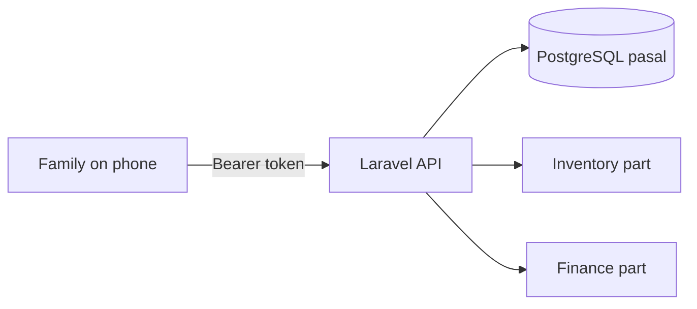

# Architecture

## Link between the two parts

A sale writes, in ONE database transaction:

1. a `sales` row and its `sale_items`
2. one `stock_movements` row per item (stock goes down)
3. a `payments` row if money was paid now

If any step fails, nothing is saved.

## One request

Route, then auth middleware, then Form Request (validation), then Controller, then Model, then API Resource (JSON).

## Folders (backend)

| Folder | Job |
|--------|-----|
| `routes/api.php` | URL list, all under `/api/v1` |
| `app/Http/Controllers` | thin: take input, call a service, return JSON |
| `app/Http/Requests` | validation rules |
| `app/Http/Resources` | JSON output shape |
| `app/Services` | sale, purchase and payment logic (the transactions) |
| `app/Models` | table classes |
| `database/migrations` | tables |
| `tests/Feature`, `tests/Unit` | automatic checks |

Stock is never edited directly. It is the sum of `stock_movements`, with a cached `quantity` on `items` updated in the same transaction.
